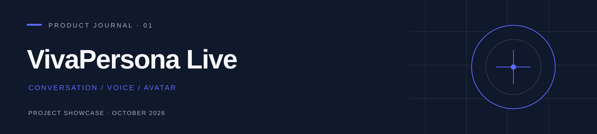

  

<h1 align="center">灵影</h1>

LingYing Live · LingYing Studio

<strong>将回答、声音与人物画面放进同一个对话空间。</strong>

重构版本介绍 · 角色与声音 · 模型连接 · 视频制作 2026 年 10 月 14 日 · 公开展示仓库，项目实现闭源

  <a href="#01-lingying-live数字人对话工作台">体验</a> ·
  <a href="#02-形象声音与模型各有位置">能力</a> ·
  <a href="#03-lingying-studio数字人视频制作">制作</a> ·
  <a href="#04-重构带来的价值">优势</a> ·
  <a href="#05-当前能力与后续方向">进展</a>

---

## 01 LingYing Live：数字人对话工作台

文字回答擅长解释问题，声音让内容更容易被听见，人物画面为交流提供可见的讲述者。将它们组合起来，才能形成数字人对话的完整体验。

**灵影面向文字、语音与数字人视频交互。** 中文统一使用“灵影”；英文以 **LingYing Live** 表示对话方向，以 **LingYing Studio** 表示视频制作方向。

在 LingYing Live 中，用户选择角色与模型连接后，可以输入问题、处理语音、聆听回答，并在已接通的数字人视频链路中观看人物讲述。重构版本围绕对话、数字人、音色库、制作和模型服务重新组织工作空间，让日常交流与服务配置各有清晰入口。

  

图 6 · 重构界面预览。截图当时右侧为静态形象，画面已标注“视频未生成”；界面图本身不代表一次实时视频执行结果。

### 让交流保持在同一个空间

对话位于主要阅读区域，数字人在侧边呈现。用户可以查看文字、处理语音，或者专注观看人物画面。当前模型名称与服务入口可见，配置变化后，用户能够知道这一轮交流使用的是哪套能力。

新建对话从角色开始。角色承载形象与交流设定，模型连接承担回答、识别和视频能力；声音选择则与角色的音色关联。重构将这些对象分开管理，为长期维护多种人物与服务连接留出清晰结构。

  

图 1 · 新建对话的视觉设计图，展示角色选择与人物预览的产品方向。此图为设计素材。

## 02 形象、声音与模型，各有位置

### 数字人：可以复用的交流角色

人物形象、人设和声音共同构成一个可选择的角色。角色管理用于创建和编辑这些设定，让科研助理、学习伙伴、课程讲述者等使用方向能够被组织起来。场景角色是产品配置与应用方向，不代表系统已自动具备相关专业能力。

  

图 3 · 数字人管理的视觉设计图。部分声音在图中明确标注待接入，人物列表属于设计示例。

当前重构前端已具备角色创建与编辑、形象预览、人设设置及声音素材管理的交互基础。实际交流效果取决于已配置的回答和媒体服务；上传参考素材也不等于完成音色克隆、知识库索引或模型训练。

### 音色库：让声音成为可管理的资产

音色库将官方声音与克隆声音入口集中呈现，提供查找、筛选和试听的产品结构。当前已接通百度配音与普通话识别；音色克隆作为扩展入口展示，不能据此理解为所有克隆后端均已可用。

  

图 2 · 音色库界面预览。声音选择与其支持的配音服务关联。

### 模型服务：四类能力，清楚选择

数字人的交流由多项能力协同完成。回答模型负责内容，语音识别处理输入，配音生成声音，数字人模型生成画面。重构版本将四类选择集中管理，并在对话中显示当前回答模型。

| 能力 | 职责 | 当前主要接入方向 |
| :--- | :--- | :--- |
| 回答模型 | 处理问题，生成文字回复 | 用户配置的 DeepSeek API 与兼容接口 |
| 语音识别 | 将语音输入转换为文字 | 百度普通话识别 |
| 语音合成 | 将回复转换为讲述声音 | 百度配音与所选音色 |
| 数字人视频 | 根据输入声音生成并播放人物画面 | 已有 FlashHead Pro 流式链路 |

  

图 5 · 模型连接的视觉设计图。图中模型名称用于说明配置方式，不承诺所有模型始终可用。

回答连接支持读取模型列表和流式文字响应。连接元数据与模型选择可以保留；当前前端的 API 密钥与额外请求头保留在页面内存，刷新后需要重新提供有效凭据。公开展示不包含可用密钥或私有服务配置。

### 视频播放：复用经过实际使用的媒体路径

重构版本继续使用已有 Pro 数字人服务与播放器：画面分块到达，音频与视频共享播放时钟，缓冲不足时同步等待，再一起恢复。播放器以少量片段建立起播缓冲，无需先等待整段人物视频全部完成。

这一设计承接 [SoulX-FlashHead](https://github.com/Soul-AILab/SoulX-FlashHead) 的流式人像生成方向。项目已有 Pro 输出与网页播放记录；具体首帧等待、整轮响应和并发能力仍取决于语言模型、配音、视频推理和网络条件，不能将“支持分块播放”直接解释为任意硬件上都能即时回应。

## 03 LingYing Studio：数字人视频制作

LingYing Studio 面向数字人视频制作。使用一段文字或已有录音，选择人物与输出设置，组织一次视频制作任务，让数字人成为内容讲述者。它适合知识讲解、课程片段、产品说明和内容展示等应用方向。

  

图 4 · 视频制作流程预览。该页面明确标注任务演示，截图对应的流程不会生成真实视频。

当前需要区分两个层次：已有数字人引擎具备视频生成能力，重构对话页已接回 Pro 媒体链路；上图独立“制作”页面仍是任务组织和恢复交互的预览，其完整生产接入尚待完成。演示进度、静态预览和下载配置均不能被算作已生成的 MP4。

后续工作将重点连接这一独立制作入口与实际执行结果，让文字或录音、任务状态、预览和最终文件形成一致的制作体验。

## 04 重构带来的价值

数字人系统的难点不限于让人物开口。多轮交流会同时涉及回答、识别、配音、视频、网络传输与浏览器播放。配置不清、声音与画面错位，或者重做界面后丢失已有稳定链路，都会影响实际使用。

下表说明本项目的工程取舍；它不是对所有数字人产品的统一判断，也不构成未经实测的速度或质量排名。

| 常见问题 | 重构版本的做法 | 带来的价值 |
| :--- | :--- | :--- |
| 配置分散，用户难以知道当前用了哪些模型 | 统一管理回答、识别、配音与数字人选择 | 服务选择更明确，问题定位有具体对象 |
| 人物、声音和回答模型混在一起，更新困难 | 将角色、音色与模型连接分别管理 | 同一人物能够复用不同已接通能力 |
| 等待整段视频生成后才开始观看 | 复用 Pro 分块传输与同步播放 | 为持续观看和较早开始播放提供基础 |
| 多条媒体轨道各自播放，容易失去同步 | 保留共享音画时钟与缓冲恢复机制 | 声音和人物画面能够一起等待和恢复 |
| 新界面开发重复实现原有媒体机制 | 新工作台接入已有服务和播放器 | 将界面升级建立在已有工程能力上 |
| 页面演示容易被误认为已完成服务接入 | 在静态形象和制作预览中显示真实状态 | 用户能够区分界面展示与实际输出 |

**本项目的优势是组合与维护数字人交互能力。** 回答、声音和画面使用独立服务连接，产品入口围绕角色和任务组织，媒体播放沿用已有稳定路径。某一能力的升级可以通过适配加入系统，而不必重新构建全部对话体验。

## 05 当前能力与后续方向

| 目前的进展 | 尚需完成的部分 |
| :--- | :--- |
| 回答 API 接入、模型列表获取与流式文字呈现 | 对不同服务、模型和网络条件持续检查兼容性 |
| 百度短句配音、识别及网页声音操作已有记录 | 真实设备、回声、持续语音交流和插话体验验收 |
| Pro 数字人输出与原播放器接入已有记录 | 多轮使用、延迟与并发指标的系统测量 |
| 角色、音色和模型服务的重构界面 | 角色与对话对象的完整服务端持久化及跨设备体验 |
| 独立视频制作页面的任务交互预览 | 对接正式执行、实际进度、失败恢复和最终视频交付 |

这里的“面向实时对话”描述项目目标和流式实现方向。完整体验仍受多个服务的累计等待影响；目前未提供经过统一协议测量的首帧延迟、端到端时延或多人并发承诺。摄像头入口、音色克隆和角色知识文件等界面扩展，也不表示相关能力已经全部接通。

接下来，我们将继续完善真实媒体任务、声音与角色的管理、设备交互和持久记录。在具体应用中，学习陪伴、知识问答、虚拟讲述者和服务接待都值得探索；专业内容的可靠性仍需由知识来源、模型能力与实际评估支撑。

如果目标是从教学材料出发制作完整课程，可查看独立项目 [Classroom Generation](https://github.com/maolinqi/Classroom-Generation-Showcase)。灵影聚焦交流与人物呈现，课堂生成聚焦内容组织和课程交付，两者通过能力适配保持各自的产品与运行边界。

---

### 展示范围与技术来源

本仓库仅公开项目介绍和用户提供的界面素材，不公开本项目实现源码、模型权重、部署配置、用户数据或凭据。图 1、3、5 是视觉设计素材；图 2、4、6 是界面预览截图，已精确裁去浏览器栏。图中旧名称对应品牌统一前的界面素材。详见 [展示素材与权利说明](NOTICE.md)。

数字人视频使用 [SoulX-FlashHead](https://github.com/Soul-AILab/SoulX-FlashHead) 等现有能力，回答与声音依赖实际配置的服务。各模型、服务和第三方组件的贡献及许可归其原作者；本项目工作集中在重构工作台、服务适配、配置管理与媒体播放组织。

灵影 · 让交流拥有声音与可见的讲述者。

