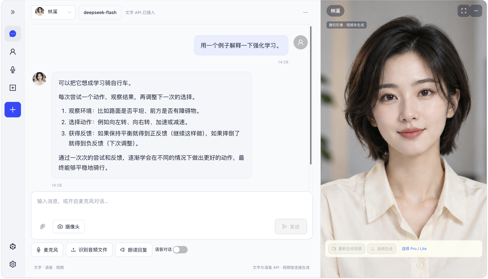
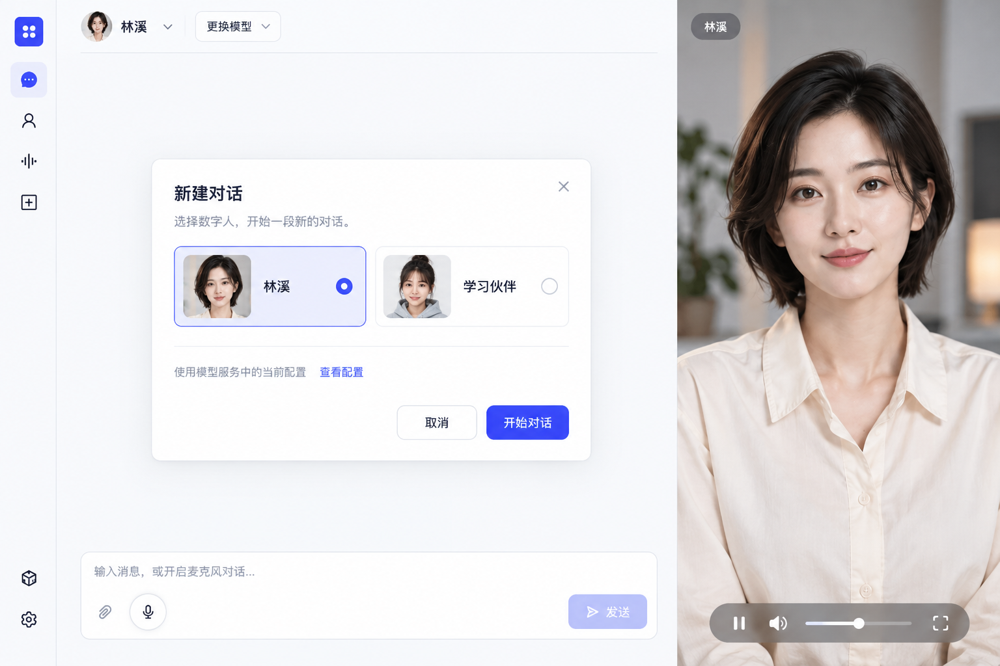
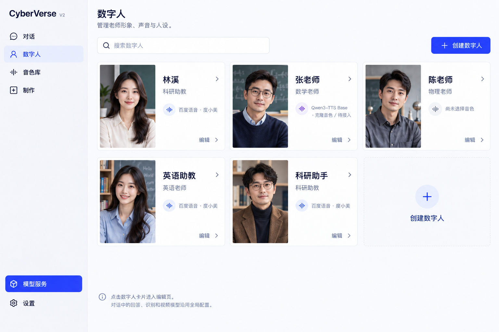
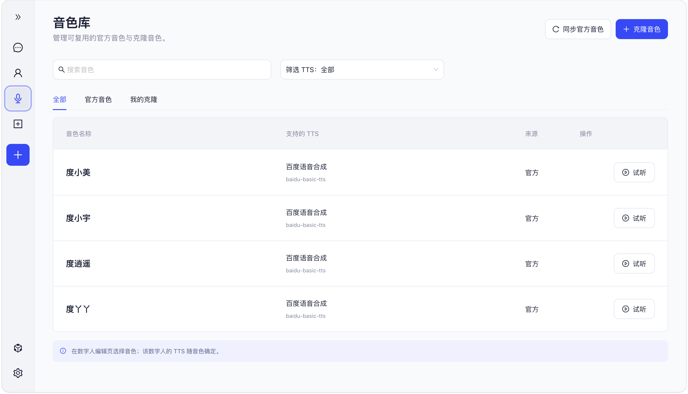
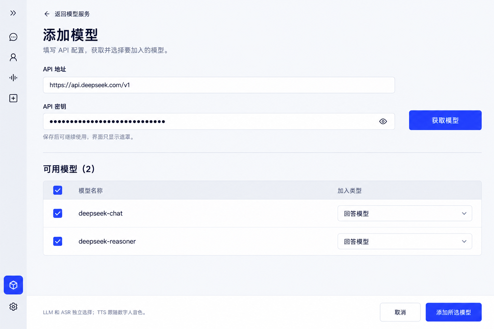
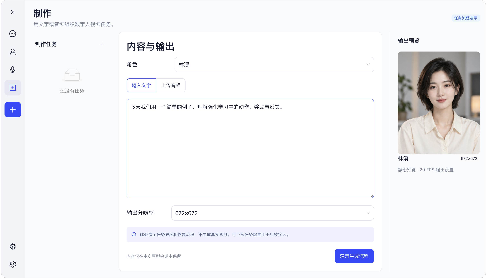

  

# 灵影 Live · 数字人交互

**让 AI 的回答拥有声音与可见的讲述者。**

提出一个问题，听见解释，也看见数字人讲述。例如，学习一个新概念时，你可以先问“用生活中的例子解释一下”，阅读回答，再聆听人物讲解；需要换一种说法时，继续在同一工作台追问。

**灵影 Live（LingYing Live）将文字问答、语音与数字人视频连接到同一个对话工作台，让用户围绕角色展开交流。** 项目面向学习问答、知识讲解与虚拟讲述，也覆盖离线数字人视频制作的应用方向。

<a href="#01-先看已有成果">已有成果</a> · <a href="#02-三个核心亮点">核心亮点</a> · <a href="#03-使用场景">使用场景</a> · <a href="#04-从交流到内容制作">视频制作</a>

## 01 先看已有成果

工作台已经组织了文字对话、语音操作与人物观看区域，并接入回答 API、百度语音和已有 Pro 数字人媒体链路。

图 6 · 界面预览，截图中的人物为静态状态。

## 02 三个核心亮点

### 让解释可以读、可以听，也有讲述者

文字便于回看，声音便于聆听，人物画面提供可见的交流对象。用户可以围绕问题理解内容，在同一个空间查看文字与人物，而无需在多个工具之间搬运回答。

### 保留熟悉的角色，按任务选择不同能力

人物形象、交流设定、声音与模型连接分别管理。用户可以保留一个熟悉的讲述者，再根据具体任务选择已接通的回答和媒体能力。角色的延续性与服务的可替换性，可以同时保留。

### 让声音与人物画面保持一致

已有播放器将音频与视频放在同一播放时钟上，片段到达后逐步播放，缓冲不足时一起等待和恢复。对用户而言，目标是让听到的声音与看到的人物保持一致，减少媒体错位带来的阅读和观看中断。

### 查看角色、声音与模型连接界面

图 1 · 新建对话设计图。

图 3 · 角色管理设计图，部分声音待接入。

图 2 · 音色库界面预览，克隆声音按实际后端支持接入。

图 5 · 模型连接设计图。

## 03 使用场景

灵影 Live 的应用可以围绕两种方式展开：实时交流用于提问、解释与继续追问；离线制作则先准备讲稿或录音，再生成人物视频，用于发布、展示和重复观看。

### 学习问答：围绕一个问题继续解释

学生或自学者从一个具体问题开始，让数字人举例解释，再围绕不理解的地方追问。文字便于核对定义，声音与人物便于讲述，熟悉的角色承接一段持续的学习交流。

### 知识讲解：让一段内容有清楚的讲述者

教师、科研团队和内容作者可以把概念解释、论文导读或流程说明交给所选角色讲述。需要交流时围绕内容继续问答；需要发布时，将整理好的讲稿或已有录音用于离线视频制作，形成可重复观看的讲解片段。

### 新闻与资讯播报：把编辑好的稿件变成主播视频

校园媒体、企业内容团队和资讯作者可以整理新闻稿、校园动态、行业简报或每日要闻，再选择人物与声音制作播报视频。数字人承担讲述者，适合栏目更新、公众号视频和信息屏播放。稿件由编辑准备与核对，同一讲述形象可以用于一组系列内容。

### 企业培训与制度宣讲：把重复讲述留下来

入职介绍、岗位培训、制度更新和内部通知，往往需要向不同批次的员工反复解释。团队可以将这些内容整理成短讲稿，制作离线数字人讲解视频，供员工按需观看；内容变化时，再调整相应稿件和视频。

### 产品介绍与操作说明：让步骤有人讲

产品团队可以围绕功能介绍、安装准备、操作步骤和常见问题制作数字人说明视频。人物负责讲解，已有截图、屏幕录制或实拍素材可以在后期剪辑中配合展示，形成面向新用户的介绍、教学短片或帮助内容。

### 活动预告与主持片段：准备可重复播放的讲述

会议、课程活动和校园项目可以提前制作活动预告、嘉宾介绍、开场欢迎或议程说明。离线生成的主持片段能够用于活动前宣传，也可以在现场按安排播放；同一人物形象与声音帮助一组内容保持一致。

### 展览与文化导览：让展品和故事有讲述者

展馆、文化项目和校园展示可以将展品介绍、历史故事或研究成果整理成数字人讲解片段，供观众扫码观看或在展示屏播放。固定内容适合离线制作，围绕内容提问则属于交互导览的应用方向。

## 04 从交流到内容制作

除了对话，灵影 Live 还面向数字人视频生成：使用文字或已有录音，选择人物与输出设置，组织一次制作任务。它与侧重完整课程的 [灵影 Studio](https://github.com/maolinqi/LingYing-Studio-Showcase) 分工不同，Live 聚焦人物交互与讲述，Studio 聚焦教学材料、课程编辑与课程交付。

图 4 · 制作流程预览，独立页面尚未完成真实生成接入。

